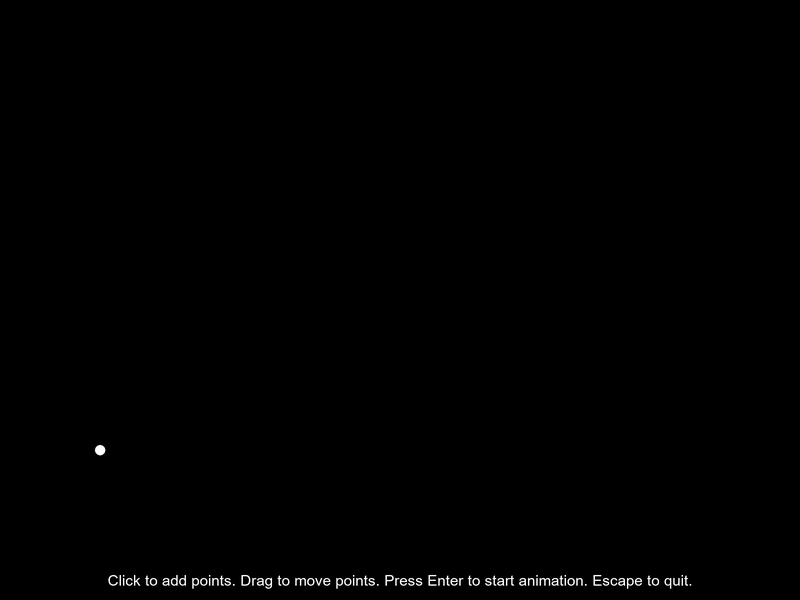

# Chaikin's Algorithm Visualization

A desktop GUI app written in Rust with [Nannou](https://nannou.cc/). It opens an 800x600 window where you click to place points, drag them around and press Enter to animate. It provides an interactive visualization of Chaikin's corner-cutting algorithm, a technique used to create smooth curves from a set of control points.

## Overview

Chaikin's algorithm is a recursive subdivision technique that progressively smooths a polyline by "cutting the corners" at each step. This visualization allows you to:

1. Place control points on a canvas
2. Watch an animated progression of the algorithm through 7 steps
3. Observe the transition from a rough line to a smooth one.

## Features

- **Interactive Control Points**: Click to place points on the canvas
- **Step-by-Step Animation**: View each iteration of the algorithm
- **Special Case Handling**: Properly handles scenarios with 1 or 2 points
- **Caching Mechanism**: Efficiently computes and stores intermediate steps
- **User Controls**:
  - `Left Mouse Button`: Add and drag control points (in Drawing mode)
  - `Enter`: Start animation (requires at least one point)
  - `Escape`: Quit the application
  - `C`: Clear points and return to Drawing mode

## Technical Implementation

The project is built with [Nannou](https://nannou.cc/), a creative coding framework for Rust, and consists of three main components:

1. **ChaikinAlgorithm**: Implements the curve generation with caching
2. **Model**: Manages application state and animation control
3. **Main**: Handles window management, user input, and rendering

## How It Works

### The Algorithm

For each step of Chaikin's algorithm:
1. For each line segment in the polyline
2. Replace the segment with two new segments by:
   - Creating a point 1/4 of the way along the segment (Q)
   - Creating a point 3/4 of the way along the segment (R)
   - Replacing the original segment with the new points

### Visualization Modes

- **Drawing Mode**: Place control points to define your initial polyline
- **Animation Mode**: Watch as the algorithm progressively refines the curve

## Building and Running

### Prerequisites

- Rust and Cargo
- Nannou dependencies

### Installation

1. Clone the repository
2. Run `cargo build`
3. Execute with `cargo run`

## Usage Tips

- Add at least 3 points for meaningful curve generation